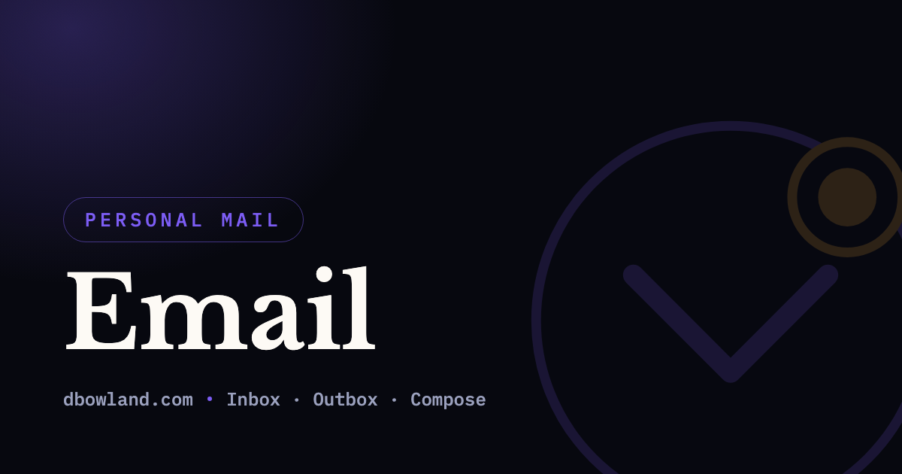

# Emails UI

[](https://email.dbowland.com/)

Next.js and Amplify front-end for emails-email-api. Example: <https://email.dbowland.com/>

## Spam Filter

Mail the inbound service classifies as spam lands in the Spam folder at `/spam` (listed in the navigation drawer between Inbox and Sent).

- **Moving mail.** In the Inbox, _Move to spam_ moves the open email to Spam. In Spam, _Not spam_ moves it back to the Inbox. Spam emails can't be bounced, since a bounce would go to a possibly forged sender.
- **Spam notice.** After a move, a notice appears above the viewer (or above the list on narrow screens). After _Not spam_ it offers to trust the sender's address or, for non-free-mail domains, the whole `@domain`. After _Move to spam_ it offers _Suggest rule changes_.
- **Suggested rule changes.** A dialog asks the API to read the moved email and suggest stricter rules (add a block phrase, remove a trusted sender, raise sensitivity). The owner picks which to apply, and each block phrase shows which Inbox subjects it would match.
- **Settings.** The _Spam filter_ section in Settings sets sensitivity (Low, Medium, High), block phrases, and trusted senders. Each list holds at most 100 entries of at most 100 characters. Saving a new block phrase that matches Inbox subjects asks for confirmation first.

Block phrases are matched as whole words after normalization (`src/services/spam-impact.ts`). `src/assets/phrase-matching-vectors.json` is shared with `emails-inbound-service`, which keeps an identical copy pinned to the same SHA-256 hash; change both copies together.

### Deploy Order

The spam filter needs the API and the inbound service to support it first. Deploy `emails-email-api`, then `emails-inbound-service`, then `emails-ui`.

## Static Site

### Prerequisites

1. [Node](https://nodejs.org/en/) 24.x (see `engines` in `package.json`)
1. [NPM](https://www.npmjs.com/)

### Local Development

The Next.js development server automatically re-renders in the browser when the source code changes. Start the local development server with:

```bash
npm run start
```

Alternatively, run a production build and serve that static content with:

```bash
npm run serve
```

Then view the server at <http://localhost:3000/>

### Unit Tests

[Jest](https://jestjs.io/) tests are run automatically on commit and push. If the test coverage threshold is not met, the push will fail. See `jest.config.js` for coverage threshold.

Manually run tests with:

```bash
npm run test
```

### Prettier / Linter

Both [Prettier](https://prettier.io/) and [ESLint](https://eslint.org/) are executed on commit. Manually prettify and lint code with:

```bash
npm run lint
```

### Deploying to Production

This project automatically deploys to production when a merge to `master` is made via a pull request.

## Deploy Script

In extreme cases, the UI can be deployed with:

```bash
npm run deploy
```

The `developer` role and [AWS SAM CLI](https://aws.amazon.com/serverless/sam/) are required to deploy this project.

### Testing the Workflow

Use [act](https://github.com/nektos/act) to test the GitHub workflow. Install it with:

```bash
brew install act
```

The workflow needs several secrets: `GIT_EMAIL`, `AWS_ACCESS_KEY_ID`, `AWS_SECRET_ACCESS_KEY`, `AWS_ACCOUNT_ID`, and `AWS_REGION`. Pass each one through from your local environment with:

```bash
act push -s GIT_EMAIL -s AWS_ACCESS_KEY_ID -s AWS_SECRET_ACCESS_KEY -s AWS_ACCOUNT_ID -s AWS_REGION
```

## Additional Documentation

### Additional Next.js Documentation

- [Documentation](https://nextjs.org/docs)

- [Pages Router](https://nextjs.org/docs/pages)

- [Static Exports](https://nextjs.org/docs/pages/building-your-application/deploying/static-exports)

### Additional Deploy Documentation

- [AWS SAM CLI](https://docs.aws.amazon.com/serverless-application-model/latest/developerguide/what-is-sam.html)

- [aws s3 sync](https://docs.aws.amazon.com/cli/latest/reference/s3/sync.html)

### Additional Workflow Documentation

- [Workflow Syntax for GitHub Actions](https://docs.github.com/en/actions/reference/workflow-syntax-for-github-actions)

- [actions/checkout](https://github.com/actions/checkout)

- [actions/setup-node](https://github.com/actions/setup-node)

- [actions/setup-python](https://github.com/actions/setup-python)

- [aws-actions/setup-sam](https://github.com/aws-actions/setup-sam)

- [aws-actions/configure-aws-credentials](https://github.com/aws-actions/configure-aws-credentials)
